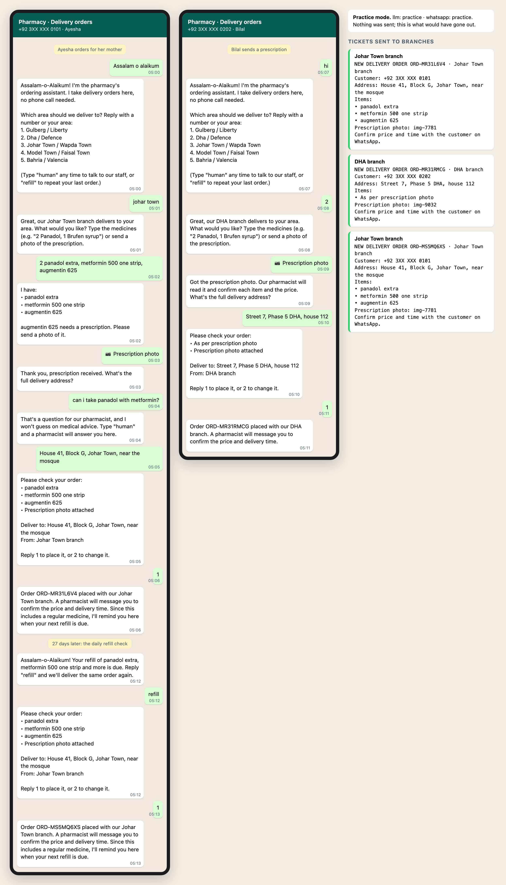

# Pharmacy WhatsApp ordering agent



A family pharmacy with five branches took delivery orders by phone call and a paper logbook. Every order needed someone free to pick up, listen and write it down. This agent takes the order in WhatsApp instead and hands the branch a clean ticket. In its first month, 97% of delivery orders went through it.

## What it does

```
customer on WhatsApp ──▶ webhook (src/server.ts) ──▶ agent (src/agent.ts)
   area → nearest branch     items (typed, or a prescription photo)
   prescription-only? ask for the photo     address → confirm
        └──▶ order saved ──▶ ticket to that branch's WhatsApp ──▶ pharmacist confirms price & time
daily (scripts/reminders.ts): regular medicines → refill reminder 3 days before they run out → "refill" reorders in one reply
```

- **A state machine, not a free chatbot.** It always knows which question it's waiting on, so an order can't skip the area, the address or the confirmation.
- **The AI model does one job:** it turns a messy message ("2 panadol, the blue sugar tablets") into a clean item list.
- **No medical advice, ever.** Dosage, interaction and "can I take…" questions go to the pharmacist. So does anything after the customer types `human`; the agent then stays quiet in that chat.
- **Prescription-only medicines** (the list in `config/branches.json`) need a photo before the order can continue.
- **Routing:** each branch lists the areas it delivers to, and the agent sends the order to the right one.

## Run it

```bash
npm run demo        # two customers, start to finish; writes docs/demo-chat.html. No keys, nothing sent.
npm start           # the webhook on :8787 (GET/POST /webhook)
npm run reminders   # the daily refill check
```

Needs Node 22.18+ (it runs TypeScript directly) and has no dependencies.

**Practice mode.** With no keys, nothing is sent: it does everything except call WhatsApp or the AI model. Add the keys to go live:
`WHATSAPP_TOKEN`, `WHATSAPP_PHONE_ID`, `WHATSAPP_VERIFY_TOKEN`, `META_APP_SECRET` (signature check on every webhook), and optionally `ANTHROPIC_API_KEY` (+ `AGENT_MODEL`) for reading free-text orders.

`config/branches.json` holds **sample** branches, numbers and areas. Replace them with the real ones.
