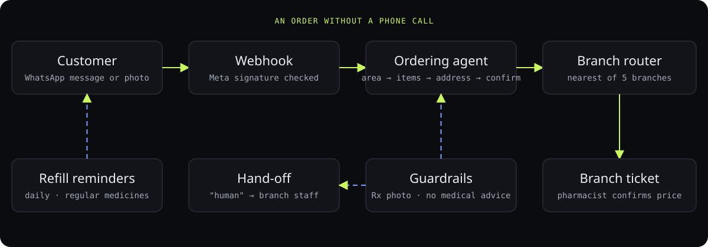

<div align="center">

# Pharmacy WhatsApp agent

**A WhatsApp ordering agent for a five-branch pharmacy: it takes the delivery order in chat, routes it to the nearest branch, and reminds patients when a refill is due.**

<p>
<a href="https://ibiraheel.com"></a>
</p>

<p>


</p>

</div>

<br>

> **97% of delivery orders went through the WhatsApp agent in its first month**  
> for a family pharmacy with five branches in Lahore

<p align="center"></p>

## What it did

Delivery ran on phone calls and a paper logbook: every order needed someone free to pick up, listen and write it down. An ordering site sent each customer to the nearest branch's WhatsApp chat in two taps, and an agent took the order there. In its first month, 97% of delivery orders went through it, and delivery orders a month grew from about 300 to 545 over three months.

The client's production setup is private. This repo is an open rebuild of how the agent works, runnable end to end with no keys.

<sub>Outcome: measured, in production. This repo: a rebuild, runs in practice mode.</sub>

## How it works

<p align="center"></p>

1. **A state machine, not a free chatbot.** The agent always knows which question it's waiting on (area → items → address → confirm), so no order skips the delivery area or the read-back.
2. **The model does exactly one job.** It turns a messy message ("2 panadol, the blue sugar tablets mom takes") into a clean item list. Everything else is deterministic code.
3. **No medical advice, ever.** Dose, interaction and "can I take…" questions are routed to the pharmacist. Prescription-only medicines need a photo before the order can continue.
4. **Staff can take over at any time.** `human` hands the chat to the branch and the agent goes quiet in it.
5. **Routing by area.** Each branch lists the areas it delivers to. The order lands as a clean ticket in that branch's WhatsApp, and the pharmacist confirms the price and time.
6. **Refills come back by themselves.** Orders with regular medicines (metformin, amlodipine…) get a reminder three days before they run out; `refill` reorders in one reply.
7. **Practice mode.** Without keys it sends nothing, and the demo shows exactly what it would have sent. The webhook checks Meta's `X-Hub-Signature-256` on every call.

## Run it locally

```bash
npm run demo        # two customers, start to finish → docs/demo-chat.html (no keys, nothing sent)
npm start           # the webhook on :8787  (GET /webhook verifies, POST /webhook receives)
npm run reminders   # the daily refill check
```

Needs Node 22.18+, which runs the TypeScript directly. No dependencies, no build step.

## Go live

| Key | For |
|---|---|
| `WHATSAPP_TOKEN`, `WHATSAPP_PHONE_ID` | replying through the WhatsApp Cloud API |
| `WHATSAPP_VERIFY_TOKEN` | Meta's one-time webhook verification |
| `META_APP_SECRET` | checking the signature on every incoming webhook |
| `ANTHROPIC_API_KEY` (+ `AGENT_MODEL`) | optional: reading free-text orders into item lists |

> [!IMPORTANT]
> `config/branches.json` holds **sample** branches, numbers and areas, and the demo customers' numbers are masked.
> Replace them with the real branches before going live.

## Repository layout

```
src/agent.ts        the conversation state machine, routing, refill reminders
src/server.ts       WhatsApp Cloud API webhook (verify + signature check)
src/providers.ts    WhatsApp + Claude, each in practice mode without keys
src/store.ts        JSON-file store (swap for a database behind the same interface)
config/branches.json branches, areas, prescription-only and regular-medicine lists
scripts/demo.ts     the end-to-end demo
scripts/reminders.ts the daily refill job
```

## Built by

[Ibi Raheel](https://ibiraheel.com): mechanical engineer, Drexel University. I build agents inside real operations.
